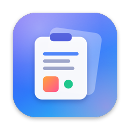
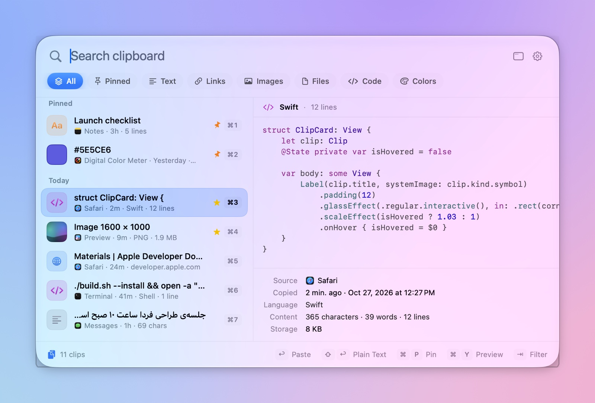
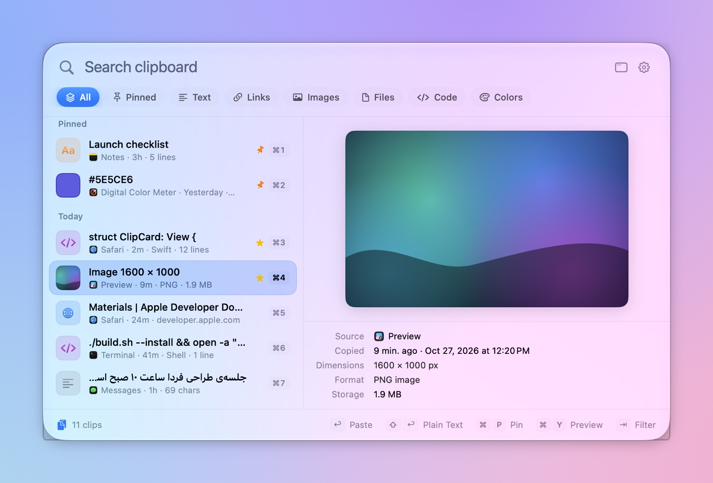
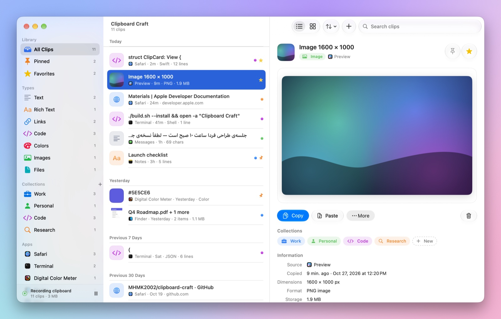
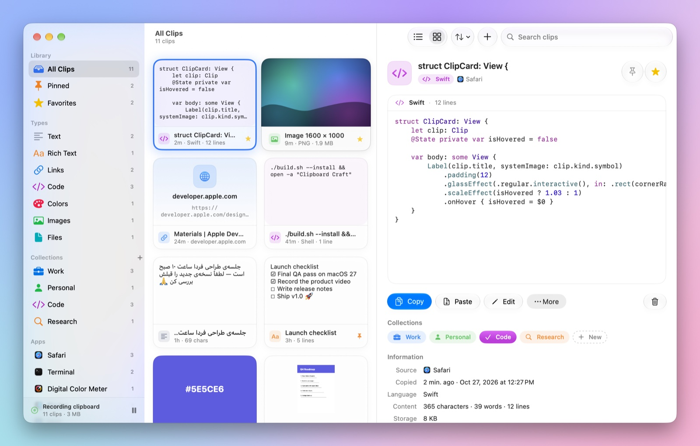
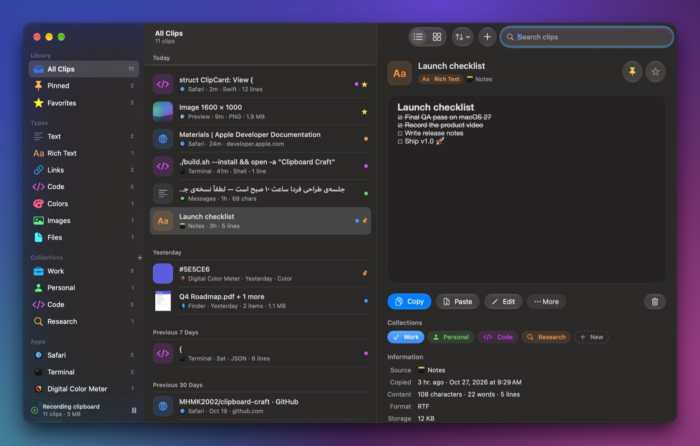
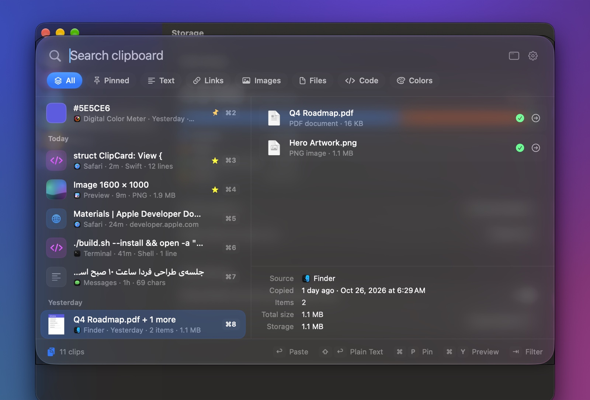
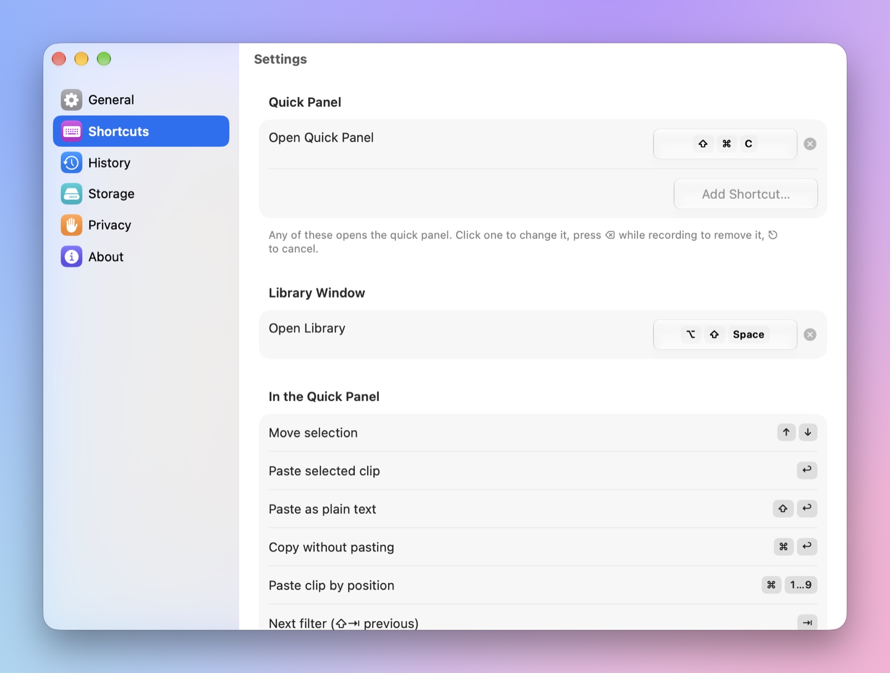
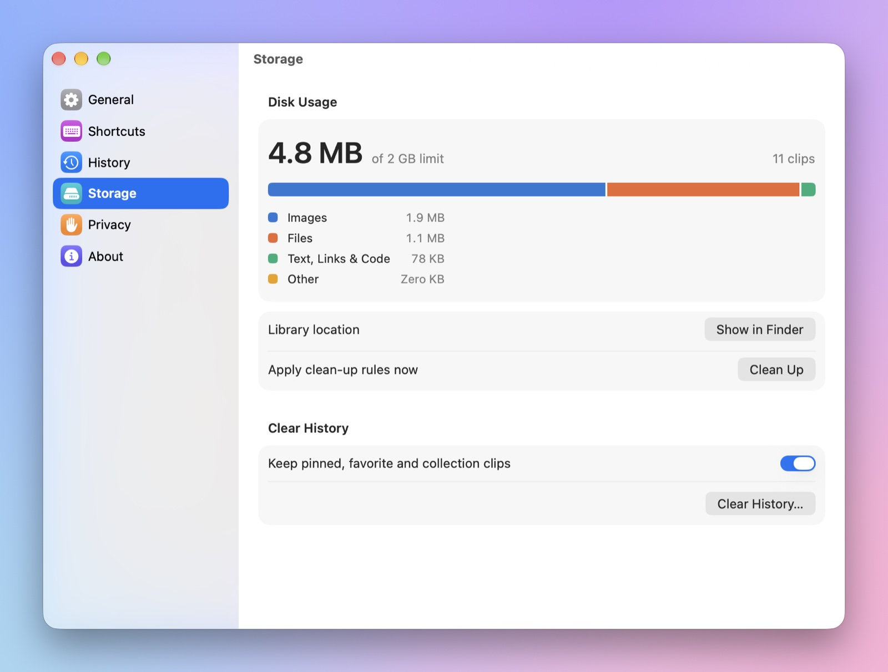

<p align="center">
  
</p>

<h1 align="center">Clipboard Craft</h1>

<p align="center">
  <b>Your smarter clipboard companion for macOS.</b><br>
  Text, links, code, colors, images and <i>real files</i> — searchable, pinnable and one shortcut away.
</p>

<p align="center">
  
  
  
  
</p>

<p align="center">
  <a href="https://github.com/MHMK2002/clipboard-craft/raw/main/releases/ClipboardCraft-1.0.0.dmg"><b>⬇︎ Download 1.0.0 (DMG)</b></a> ·
  <a href="#features">Features</a> ·
  <a href="#keyboard-shortcuts">Shortcuts</a> ·
  <a href="#build-from-source">Build</a> ·
  <a href="README.fa.md">فارسی</a>
</p>

<p align="center">
  
</p>

## Why Clipboard Craft?

- **Everything you copy, remembered** — text, rich text, links, code, colors, images, files and any other pasteboard data.
- **Real files, not just paths** — copied files are archived, so you can paste them again even after the original was moved or deleted.
- **Always one shortcut away** — <kbd>⇧</kbd><kbd>⌘</kbd><kbd>C</kbd> (or any shortcuts you choose) opens a floating Liquid Glass panel. Type, pick, press <kbd>↩</kbd> to paste.
- **Built for macOS 26/27** — native SwiftUI and AppKit, Liquid Glass, light and dark mode, no Electron, no telemetry.
- **Private by design** — passwords and other concealed content are never recorded, everything stays on your Mac.

## Screenshots

| Quick panel | Image preview |
|---|---|
|  |  |
| **Library** | **Grid view** |
|  |  |
| **Dark mode** | **Files in the quick panel** |
|  |  |
| **Multiple shortcuts** | **Storage** |
|  |  |

## Install

1. Download **[ClipboardCraft-1.0.0.dmg](https://github.com/MHMK2002/clipboard-craft/raw/main/releases/ClipboardCraft-1.0.0.dmg)** (or the [ZIP](https://github.com/MHMK2002/clipboard-craft/raw/main/releases/ClipboardCraft-1.0.0.zip)) and drag **Clipboard Craft** into **Applications**.
2. The app is not notarized by Apple, so the first launch is blocked. Open **System Settings › Privacy & Security** and click **Open Anyway** — or run:
   ```sh
   xattr -dr com.apple.quarantine "/Applications/Clipboard Craft.app"
   ```
3. To paste straight into the app you're working in, allow **Clipboard Craft** under **System Settings › Privacy & Security › Accessibility**. Without it, clips are copied and you press <kbd>⌘</kbd><kbd>V</kbd> yourself.

Requires macOS 26 Tahoe or later. Universal binary (Apple Silicon and Intel). Checksums: [`releases/ClipboardCraft-1.0.0.sha256`](releases/ClipboardCraft-1.0.0.sha256).

## Features

### Smart history
- Monitors the clipboard in the background and records the source app of every clip.
- Detects the content type: plain text, rich text (RTF/HTML), links, **code with language detection** (Swift, Python, JavaScript/TypeScript, Go, Rust, SQL, Shell, JSON, HTML, CSS, YAML and more), **colors** (HEX/RGB/HSL), images, files and unknown data.
- Duplicate handling: move the existing clip to the top, keep every copy, or ignore the new one.
- Timeline grouping — Pinned, Today, Yesterday, Previous 7 Days, …
- **Instant search** across text, file names, paths, URLs, app names and metadata, with tokens: `type:image`, `is:pinned`, `is:fav`, `app:safari`, `in:work`.
- Persian/Arabic-aware search: ی/ي, ک/ك, zero-width non-joiners and Persian digits all match.
- **Pins, favorites and collections** (Work, Personal, Code and Research to start; create your own with icons and colors).
- Automatic clean-up by age, number of clips or disk space — pinned, favorite and collection clips are never removed.

### Real files and images
- Copies of files copied in Finder are archived (APFS clones, so they take almost no extra space).
- Paste one or many files back into Finder or any other app; if the original moved, the archived copy is used.
- QuickLook thumbnails, file name, kind, size, path and the status of the original.
- Large TIFF images (e.g. screenshots) are stored as PNG; TIFF is generated on demand when an app asks for it.
- All pasteboard flavours are stored raw, so pasting a clip again is faithful to the original.

### Quick panel
- Floating Liquid Glass panel that never steals focus from the app you're in.
- Search as you type, filter by type with <kbd>⇥</kbd>, live preview, paste with <kbd>↩</kbd>.
- Open it with **several shortcuts** — <kbd>⇧</kbd><kbd>⌘</kbd><kbd>C</kbd> by default, add more in Settings.

### Library window
- Sidebar with library, types, collections and source apps.
- List and grid views, sorting, multi-selection and batch actions.
- Inspector with full preview, text editing, code language switching, export and collections.
- Drag & drop files and images in; drag clips out to Finder, other apps or onto a collection.
- Undo for deletions (<kbd>⌘</kbd><kbd>Z</kbd> or the toast's **Undo** button).

### Settings
- Open at login, light/dark/system theme, customizable shortcuts.
- Storage usage by type, clean-up rules and clear history.
- Privacy: ignores concealed content (password managers), per-app ignore list, pause recording, opt-in link previews.

## Keyboard shortcuts

| Where | Keys | Action |
|---|---|---|
| Anywhere | <kbd>⇧</kbd><kbd>⌘</kbd><kbd>C</kbd> | Open the quick panel (configurable, add as many as you like) |
| Anywhere | <kbd>⇧</kbd><kbd>⌥</kbd><kbd>Space</kbd> | Open the library window |
| Quick panel | <kbd>↑</kbd> <kbd>↓</kbd> | Move selection |
| Quick panel | <kbd>↩</kbd> / <kbd>⇧</kbd><kbd>↩</kbd> / <kbd>⌘</kbd><kbd>↩</kbd> | Paste / paste as plain text / copy only |
| Quick panel | <kbd>⌘</kbd><kbd>1</kbd> … <kbd>⌘</kbd><kbd>9</kbd> | Paste the n-th clip |
| Quick panel | <kbd>⇥</kbd> / <kbd>⇧</kbd><kbd>⇥</kbd> | Next / previous type filter |
| Quick panel | <kbd>⌘</kbd><kbd>P</kbd> / <kbd>⌘</kbd><kbd>S</kbd> | Pin / favorite |
| Quick panel | <kbd>⌘</kbd><kbd>Y</kbd> | Large preview |
| Quick panel | <kbd>⌘</kbd><kbd>⌫</kbd> / <kbd>⌘</kbd><kbd>Z</kbd> | Delete / undo |
| Quick panel | <kbd>⌘</kbd><kbd>O</kbd> | Show the clip in the library |
| Quick panel | <kbd>⎋</kbd> | Clear search, then close |

## Build from source

Only the Command Line Tools are needed — no Xcode project.

```sh
git clone git@github.com:MHMK2002/clipboard-craft.git
cd clipboard-craft
./build.sh --install --run   # build, copy to /Applications and launch
```

| Command | What it does |
|---|---|
| `./build.sh` | Release build → `build/Clipboard Craft.app` |
| `./build.sh --run` / `--install` / `--debug` / `--universal` | Launch / copy to `/Applications` / debug build / Apple Silicon + Intel |
| `./test.sh` | Run the test suite (Swift Testing) |
| `Scripts/package.sh` | Universal build → DMG, ZIP and checksums in `releases/` |
| `Scripts/screenshots.sh` | Regenerate `docs/screenshots` with demo data |

Notes:
- With only the Command Line Tools, the macOS 27 SDK can't expand SwiftUI's `@State` macro (its plugin ships with Xcode), so the scripts pin the newest macOS 26 SDK. The app runs fine on macOS 27.
- `build.sh` signs with a self-signed local identity kept in `.signing/` (its own keychain, git-ignored). A stable signature means macOS keeps the Accessibility permission across rebuilds.

## Project layout

```
Sources/ClipboardCraft/
  App/          launch, menu bar item, windows, main menu, debug/showcase helpers
  Core/         models, SQLite store, blob storage, clipboard monitor, classification,
                code detection & highlighting, colors, paste service, global hot keys
  UI/
    QuickPanel/ floating glass panel
    Main/       library window: sidebar, list/grid, inspector, sheets
    Preview/    previews for every content type
    Settings/   settings window
Tests/          Swift Testing suites for the core
Scripts/        icon rendering, packaging, screenshots
```

Data lives in `~/Library/Application Support/Clipboard Craft/` (`library.sqlite` plus a `Blobs/` folder with the stored clipboard data and archived files).
